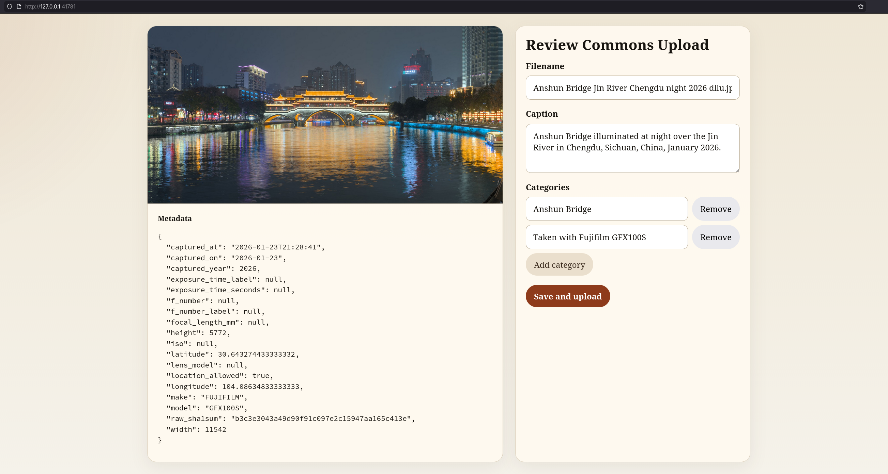

# pupphoto
some random scripts to organize my photos

Install dependencies with:

```bash
uv sync
```

Project configuration now lives in `config.toml`. It is loaded through the typed dataclasses in `config.py`, so paths are represented as `pathlib.Path` and the old split config sources are gone.

Example `config.toml`:

```toml
[import]
camera_dir = "/mnt/camera/DCIM"
photo_destination = "/home/your-user/pictures/raw"
video_destination = "/home/your-user/videos"
supported_raw_formats = [".raf", ".dng", ".cr3", ".arw"]
supported_video_formats = [".mov", ".mp4", ".avi", ".mkv"]

[photo_library]
hot_root = "/home/your-user/pictures"
cold_root = "/mnt/dataz/pictures"
raw_subdir = "raw"
cooked_subdir = "cooked"
darktable_cli = "/opt/darktable/bin/darktable-cli"

[upload]
pictures_dir = "~/Pictures"
thumb_dir = "~/Pictures/thumbs"
rclone_destination = "b2:your-bucket"
public_base_url = "https://example.com"
blog_image_dir = "/home/your-user/proj/your-site/img"

[album]
template_path = "static/album_template.html"
output_dir = "/tmp"
rsync_destination = "your-host:/www/path"
public_base_url = "https://example.com/public"
max_workers = 12

[openai]
api_key = "sk-..."
vision_model = "gpt-6.1-sol"
image_detail = "high"
downsized_max_dimension = 1600

[commons]
api_url = "https://commons.wikimedia.org/w/api.php"
username = "YourCommonsUsername"
password = "YourCommonsPassword"
author = "Your Name"
license_wikitext = "{{self|cc-by-sa-4.0}}"
filename_suffix = ""
search_limit_per_query = 8
max_candidate_categories = 40
max_parent_depth = 3
ui_host = "127.0.0.1"
quality_images_category = "Quality images by YourCommonsUsername"
featured_pictures_category = "Featured pictures by YourCommonsUsername"
valued_images_category = "Valued images by YourCommonsUsername"

[[banned_areas]]
name = "home"
latitude = 37.8268292
longitude = -122.4231893
radius_meters = 500
```

Run the scripts with `uv run python ...`:

```bash
uv run python import.py
uv run python export_photos.py
uv run python export_photos.py --root cold
uv run python export_photos.py --root all --dry-run
uv run python sync_hot_to_cold.py
uv run python sync_hot_to_cold.py --dry-run
uv run python upload_photo.py path/to/photo.jpg
uv run python upload_clipboard.py path/to/photo.jpg
uv run python upload_blog.py path/to/photo.jpg
uv run python albumize.py path/to/photo1.jpg path/to/photo2.jpg
uv run python open_gps_google_maps.py path/to/photo.jpg
uv run python upload_commons.py path/to/photo.jpg
uv run python upload_commons.py path/to/photo1.jpg path/to/photo2.jpg path/to/photo3.jpg
uv run python tag_promoted_images.py
```

`import.py` imports from the configured camera directory, stores photos and videos in the configured destinations, and renames files to date, original filename, and the SHA1 of the raw file. For example, `DSCF2300.JPG` and `DSCF2300.RAF` become `2023-10-01-11-36-11_DSCF2300_53e266aac66a4b9cb37380214334d15b58517061.jpg` and `2023-10-01-11-36-11_DSCF2300_53e266aac66a4b9cb37380214334d15b58517061.raf`.

`upload_commons.py` opens a local review UI on a randomized localhost port and only uploads after you press the button. With one path it proposes a filename, caption, and Commons categories as before. With multiple paths it analyzes the ordered photos together, searches for categories using evidence from the whole group, and proposes consistent per-photo captions and filenames such as `Shared subject 01 suffix.jpg`, `Shared subject 02 suffix.jpg`, and so on. Numbering follows the command-line order. Each uploaded description includes a gallery linking all files in the batch. Each proposal remains editable, and the batch is uploaded sequentially after review. Configure OpenAI credentials, Commons credentials, author name, filename suffix, and license in `config.toml`. If a photo has GPS coordinates inside a configured `banned_areas` radius, its Commons description omits the location and its upload is sent from a temporary copy with GPS EXIF removed.

The Commons categorization workflow has four stages:

1. `openai.vision_model` (default: `gpt-6.1-sol`) inspects the ordered photos, metadata, and optional hint through the Responses API. It writes a shared filename stem and per-photo captions, and proposes category search queries covering identity, visible color and body form, activity or state, and useful subject/place combinations. Limited web search helps identify specific or recent subjects.
2. Commons API searches and exact title checks find candidate categories. Bounded graph traversal explores parents and children and records file counts.
3. The [OpenAI Decisions API](https://developers.openai.com/api/docs/guides/decisions) with `gpt-6-luna` evaluates each nonempty candidate category for each photo against the shared group context. Checks are split into requests of at most 400 questions, each with the full group context, and their results are combined. Categories with applicability probability at least 0.5 proceed to review; refused questions are skipped.
4. `openai.vision_model` reviews the applicable categories together for each photo. It removes redundant generic classes and bare location categories while retaining independent color, state, and subject/place intersections. This review can only remove categories already selected for that photo. The workflow also removes empty categories and graph ancestors, and can replace selected parents with a nonempty shared child when the photo context explicitly supports its name. Equipment and exposure categories are resolved separately from EXIF.

Single photos and batches use the same analysis pipeline. All proposals remain editable before upload. Category discovery and refinement live in `commons_categories.py`; the review page uses the Jinja template `static/commons_upload.html`, with separate CSS and JavaScript files. The minimal Catppuccin Latte theme uses Source Sans Pro and Source Code Pro, loaded from Google Fonts with local font fallbacks.

New Commons uploads stop if the filename is already taken; edit the filename in the review UI and submit again. This applies to both regular and chunked uploads. Replacing an existing file requires the explicit overwrite action offered for matching raw SHA1 photos.

`tag_promoted_images.py` scans your Commons user talk page and its archive subpages for Quality Image, Featured Picture, and Valued Image promotion notices, including Featured Picture notices for images nominated by others. It adds the corresponding configured personal category when missing only if the file's author metadata credits your Commons username in plain text or links to your Commons user page. Files with missing or unrecognized author attribution are skipped; uploading or nominating a file does not establish authorship. Configure `commons.quality_images_category`, `commons.featured_pictures_category`, and `commons.valued_images_category` in `config.toml`.

## Screenshot


